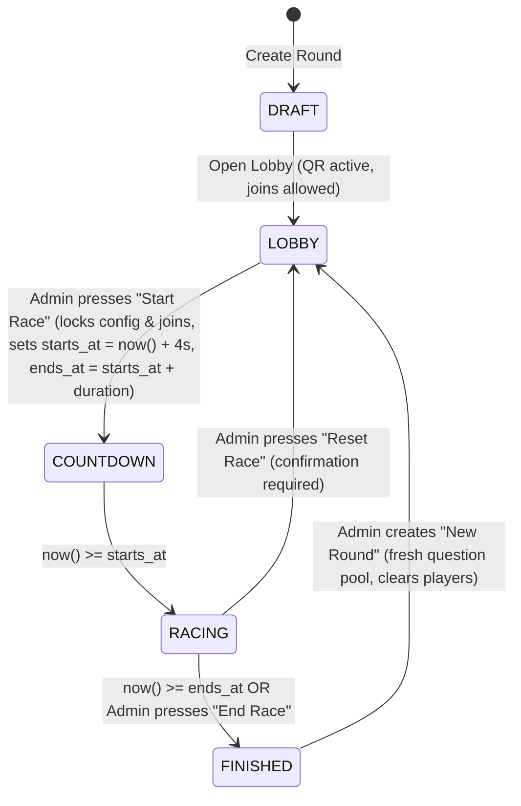
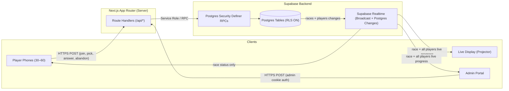

# Phase 2: Product Definition & Architecture Specification

## 1. Product Requirements (PRD) Summary
- **Product:** IEEE Strategic Racing Quiz — a real-time multiplayer racing quiz for live events.
- **Surfaces:**
  1. **Player (`/` or `/play`):** Mobile-first (`360–430px`), QR entry, nickname join, lobby wait, difficulty choice (`Easy +1`, `Medium +2`, `Hard +3`), MCQ view, immediate feedback + 3s lockout on wrong answer, personal progress & rank at race end.
  2. **Live Race Display (`/display`):** Read-only `1920x1080` / `4K` projector view. Join QR + participant counter in lobby; 3-2-1 start lights; adaptive track (≤20 cars = full lanes, >20 = top 12 lanes + compact field strip for all cars); auto-zoom horizontal scale; floating `+1` (Green), `+2` (Blue), `+3` (Gold) step indicators; live leaderboard tower; global countdown (`Orbitron`); podium celebration at `00:00`.
  3. **Admin Portal (`/admin`):** Password-protected (`httpOnly` session cookie). Race lifecycle controls (Lobby → Countdown → Racing → Finished → Reset / New Round), race config (duration default `180s`, pool distribution default `10/10/10`, rewards `1/2/3`, allow abandon toggle), live participant moderation (rename/remove), question bank CRUD + CSV/JSON import/export, round results CSV export.

---

## 2. User Flows

### Player Flow
1. Scan QR code → lands on `/play?race=<id>` (or active race).
2. Enter nickname (`2–16` chars, validated against profanity & duplicates). Server issues a signed/opaque `player_token` stored in `localStorage` + `cookie` and assigns a car number (`#01–#99`) and color.
3. **Lobby:** Sees assigned car number, nickname, and "Waiting for race start…".
4. **Countdown / Start:** Global `starts_at` triggers `3–2–1–GO!`.
5. **Difficulty Selection:** Sees 3 cards:
   - **Easy (+1 Step)** — remaining count shown
   - **Medium (+2 Steps)** — remaining count shown
   - **Hard (+3 Steps)** — remaining count shown
   - If a tier has 0 unanswered questions left for this player, the card shows the diagonal hatch texture and "Completed".
6. **Question Screen:** Server assigns a random unanswered question from the chosen tier and creates a pending `attempt` row. Player sees question prompt (and optional code block) + 4 options (`A, B, C, D`), plus an **Abandon question** button (if enabled).
   - **Submit Answer:** Server validates `now() < ends_at`, checks answer, updates steps (`+1/+2/+3` or `0`), sets `lockout_until = now() + 3s` if wrong, and returns `{ correct, stepsEarned, totalSteps, lockoutUntil }`.
   - **Abandon Question:** Server marks attempt as `abandoned`, grants `0` steps, no lockout, never reveals answer, returns player to Difficulty Selection.
7. **Lockout (Wrong Answer):** 3-second visual cooldown bar before returning to Difficulty Selection.
8. **Finished (`now() >= ends_at`):** Input locks immediately; displays final rank, total steps, correct count, and winner announcement.

---

## 3. Game State Machine & Lifecycle



---

## 4. Architecture & Real-Time Sync Strategy (Next.js + Supabase)



### Why this stays within Supabase Free Tier Quotas (200 connections, 100 msgs/sec)
1. **Channel split:**
   - `race-state` channel: broadcasts only lifecycle changes (`LOBBY`, `COUNTDOWN`, `RACING`, `FINISHED`, `RESET`) + `starts_at` / `ends_at`. Subscribed by **all clients** (~60 connections, <1 msg/min).
   - `race-standings` channel: streams `players` row updates (or batched 250ms broadcast pulses from API). Subscribed **only by Display and Admin** (2 connections, ~5–15 msgs/sec).
2. **Players do NOT subscribe to other players' movements** during the race; they get their own updated score in the HTTP response of their answer submission.
3. **Clock Sync:** On load, every client calls `GET /api/time` 3 times, computes median round-trip latency and `serverTimeOffset = serverNow - clientNow`. All countdown UI renders `endsAt - (Date.now() + serverTimeOffset)`.
4. **Authoritative Cut-off:** Every answer/pick RPC checks `now() >= race.starts_at AND now() < race.ends_at` using Postgres transaction time. Late packets after `00:00` are rejected even if a phone's clock is tampered with.

---

## 5. Database Schema (Supabase Postgres)

### `races`
| Column | Type | Notes |
|---|---|---|
| `id` | `uuid` PK | Default `gen_random_uuid()` |
| `name` | `text` | e.g., `"Round 1"` |
| `status` | `text` | `'LOBBY' \| 'COUNTDOWN' \| 'RACING' \| 'FINISHED'` |
| `duration_sec` | `int` | Default `180` |
| `easy_count` | `int` | Default `10` |
| `medium_count` | `int` | Default `10` |
| `hard_count` | `int` | Default `10` |
| `easy_reward` | `int` | Default `1` |
| `medium_reward` | `int` | Default `2` |
| `hard_reward` | `int` | Default `3` |
| `allow_abandon` | `boolean` | Default `true` |
| `starts_at` | `timestamptz` | Nullable; set to `now() + 4s` on Start |
| `ends_at` | `timestamptz` | Nullable; set to `starts_at + duration_sec` |
| `created_at` | `timestamptz` | Default `now()` |

### `questions`
| Column | Type | Notes |
|---|---|---|
| `id` | `uuid` PK | |
| `difficulty` | `text` | `'EASY' \| 'MEDIUM' \| 'HARD'` |
| `category` | `text` | `'HTML' \| 'CSS' \| 'JS' \| 'React' \| 'Fundamentals' \| 'APIs' \| 'Logic'` |
| `prompt` | `text` | Question text |
| `code_snippet` | `text` | Nullable code block |
| `options` | `jsonb` | `string[4]` (`["...", "...", "...", "..."]`) |
| `correct_index` | `int` | `0..3` — **RLS blocks anon SELECT on this table** |
| `enabled` | `boolean` | Default `true` |

### `race_questions` (the locked question pool for a specific race)
| Column | Type | Notes |
|---|---|---|
| `race_id` | `uuid` FK | References `races(id) ON DELETE CASCADE` |
| `question_id` | `uuid` FK | References `questions(id)` |
| `difficulty` | `text` | Denormalized for fast lookup |
| PK | `(race_id, question_id)` | |

### `players`
| Column | Type | Notes |
|---|---|---|
| `id` | `uuid` PK | |
| `race_id` | `uuid` FK | References `races(id) ON DELETE CASCADE` |
| `nickname` | `text` | Unique per `race_id` (case-insensitive) |
| `car_number` | `int` | Sequential `1..N` per race |
| `car_color` | `text` | Assigned from curated non-yellow palette |
| `token_hash` | `text` | SHA-256 of secret `player_token` (never exposed to public) |
| `total_steps` | `int` | Default `0` |
| `correct_count` | `int` | Default `0` |
| `wrong_count` | `int` | Default `0` |
| `abandoned_count` | `int` | Default `0` |
| `last_score_at` | `timestamptz` | Timestamp of most recent positive step gain (for tie-break #2) |
| `lockout_until` | `timestamptz` | Nullable; set to `now() + 3s` on wrong answer |
| `last_step_delta` | `int` | `1 \| 2 \| 3` — drives the Display `+1/+2/+3` pop animation |
| `last_step_difficulty` | `text` | `'EASY' \| 'MEDIUM' \| 'HARD'` |
| `joined_at` | `timestamptz` | Default `now()` |

### `attempts`
| Column | Type | Notes |
|---|---|---|
| `id` | `uuid` PK | |
| `race_id` | `uuid` FK | |
| `player_id` | `uuid` FK | |
| `question_id` | `uuid` FK | |
| `difficulty` | `text` | `'EASY' \| 'MEDIUM' \| 'HARD'` |
| `status` | `text` | `'ACTIVE' \| 'CORRECT' \| 'WRONG' \| 'ABANDONED'` |
| `selected_index` | `int` | Nullable |
| `steps_awarded` | `int` | Default `0` |
| `created_at` | `timestamptz` | Default `now()` |
| `resolved_at` | `timestamptz` | Nullable |
| Unique | `(player_id, question_id)` | Prevents answering/receiving the same question twice |

### Winner & Ranking Order (SQL)
```sql
ORDER BY
  total_steps DESC,
  correct_count DESC,
  COALESCE(last_score_at, joined_at) ASC,
  car_number ASC
```

---

## 6. Anti-Cheat & Fairness Guarantees
1. **No client-side answers:** `questions` table has RLS enabled with **zero public policies**. Questions are served only through `/api/player/pick-difficulty`, which strips `correct_index`.
2. **One active question at a time:** If a player refreshes mid-question, `/api/player/me` returns their existing `ACTIVE` attempt so refreshing cannot skip a hard question for free.
3. **Abandon burns the question:** Abandoning transitions `status = 'ABANDONED'` while keeping the `(player_id, question_id)` unique row, so the question can never be drawn again by that player.
4. **Server-enforced lockout:** `/api/player/pick-difficulty` rejects requests when `now() < player.lockout_until`.
5. **Idempotent submissions:** Submitting an already-resolved `attempt_id` returns the existing result without double-counting steps.

---

## 7. Proposed Repository Structure
```text
d:\Projects2026\IEEE-game\
├── .project/                      # Project state, decisions, specs
├── supabase/
│   ├── migrations/
│   │   └── 0001_init_schema.sql   # Tables, indexes, RLS, atomic RPCs
│   └── seed/
│       └── questions_90.json      # 90 Web Dev questions (30 E / 30 M / 30 H)
├── src/
│   ├── app/
│   │   ├── layout.tsx             # Geist, Geist Mono, Orbitron fonts + base tokens
│   │   ├── globals.css            # Design tokens + hatch utility + reduced motion
│   │   ├── page.tsx               # Player entry / redirect to active race
│   │   ├── play/
│   │   │   └── page.tsx           # Mobile Player surface
│   │   ├── display/
│   │   │   └── page.tsx           # 1080p/4K Live Race Display surface
│   │   ├── admin/
│   │   │   ├── login/page.tsx     # Admin password login
│   │   │   └── page.tsx           # Admin Portal (Race, Players, Questions, Results)
│   │   └── api/
│   │       ├── time/route.ts      # Server clock sync endpoint
│   │       ├── race/state/route.ts
│   │       ├── player/
│   │       │   ├── join/route.ts
│   │       │   ├── me/route.ts
│   │       │   ├── pick/route.ts
│   │       │   ├── submit/route.ts
│   │       │   └── abandon/route.ts
│   │       └── admin/
│   │           ├── login/route.ts
│   │           ├── race/route.ts
│   │           ├── players/route.ts
│   │           ├── questions/route.ts
│   │           └── export/route.ts
│   ├── components/
│   │   ├── ui/                    # Re-implemented primitives (Button, Card, Badge, CodeBlock, CopyButton)
│   │   ├── player/                # JoinForm, LobbyCard, DifficultyPicker, QuestionCard, LockoutOverlay, FinalResult
│   │   ├── display/               # TopBroadcastBar, StartLights, RaceTrack, CarLane, FieldStrip, TimingTower, PodiumModal
│   │   └── admin/                 # AdminShell, RaceControls, ConfigForm, ParticipantsTable, QuestionBankManager
│   └── lib/
│       ├── cn.ts
│       ├── engine/                # Pure game rules, ranking comparator, auto-zoom scale math, profanity check
│       ├── supabase/              # Server & client Supabase instances + Realtime hooks
│       ├── clock.ts               # NTP-style client clock offset estimator
│       └── audio.ts               # Web Audio API synth cues for Display (start lights, +1/+2/+3, lead change, finish)
└── scripts/
    └── simulate-bots.ts           # Phase 5 load-test script (50–100 concurrent virtual players)
```
